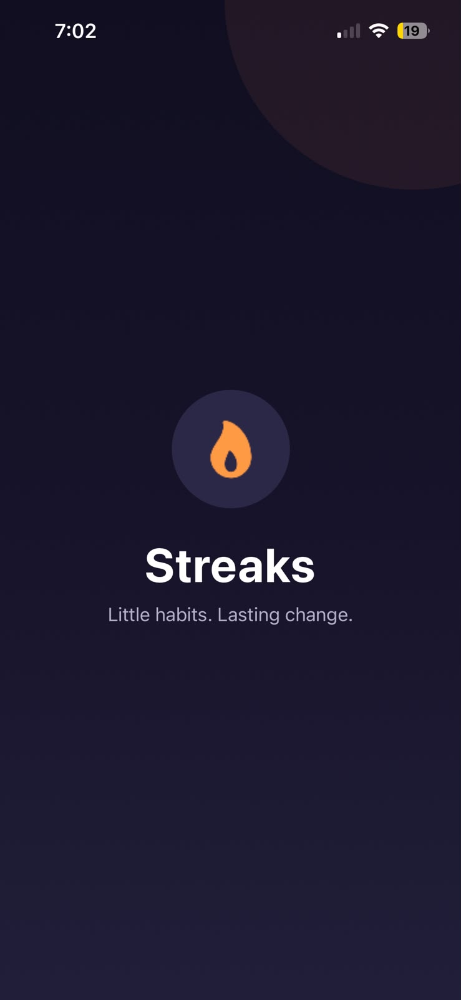
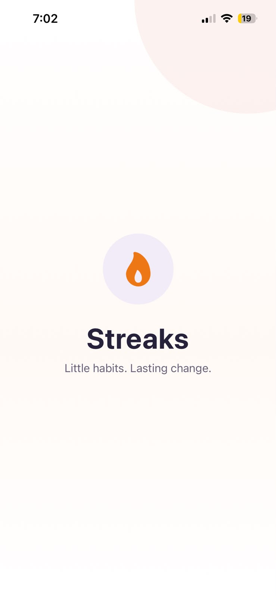
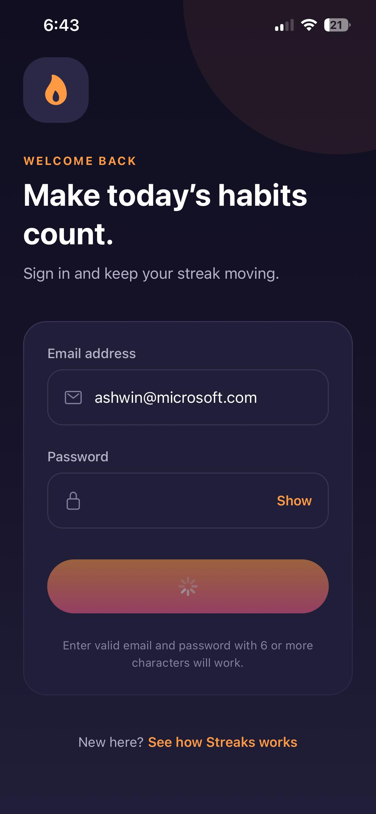
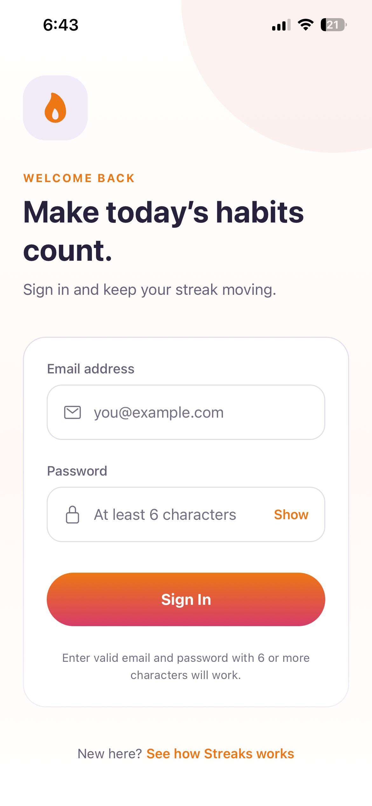
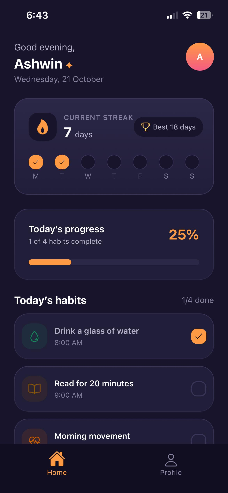
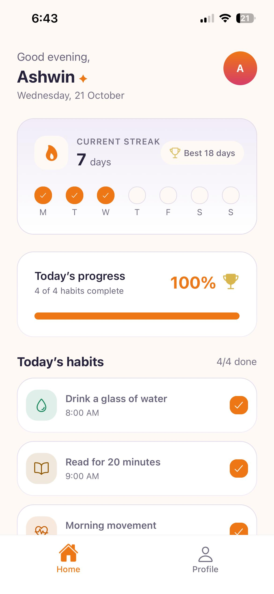
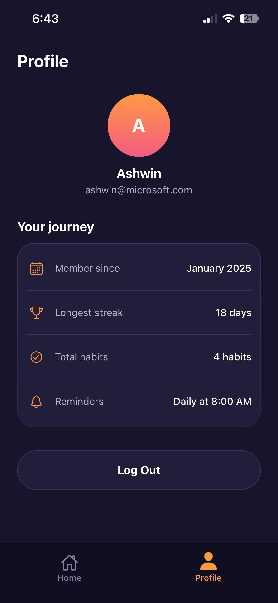
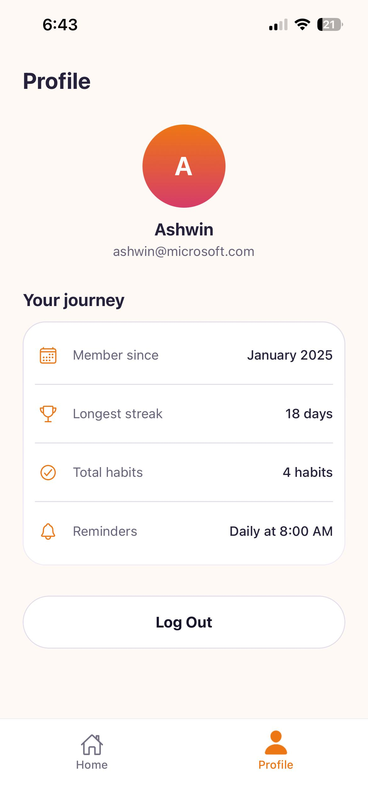

# Streaks – Habit Tracker App

  Streaks is a modern, mobile-first habit-tracking app built with React Native and Expo. It features animated onboarding, a mock sign-in flow, and a personalized home screen where users can track their daily habits and progress.

  The app supports **both light and dark modes**, automatically adapting its UI to the device's appearance settings for a consistent user experience.

## Tech Stack

- React Native, Expo SDK 57, and TypeScript
- Expo Router for file-based navigation and bottom tabs
- React Native Reanimated and SVG for animations and illustrations
- AsyncStorage for local session and onboarding persistence
- Expo Linear Gradient, Safe Area Context, and Expo Vector Icons
- Theme tokens for colors, typography, spacing, and border radius

## Key Features

- Animated splash screen and onboarding with four slides
- Mock sign-in with email and password validation
- Personalized home screen with daily habits and streak summaries
- Animated habit completion and progress indicators
- Profile screen with logout functionality
- Automatic light and dark theme support based on device settings
- Reusable components and organized TypeScript code

## Light and Dark Mode

Streaks automatically follows the device's appearance settings and updates the app's colors and UI accordingly.

- **Light mode:** Uses a bright, clean interface with light backgrounds and contrasting text.
- **Dark mode:** Uses darker backgrounds and theme-appropriate text and accent colors for a comfortable viewing experience.

Both themes share the same layout and functionality, providing a consistent experience across the app.

## Screenshots

All screenshots are stored in [`screenshots/`](./screenshots/).

### Splash

| Dark mode Lightmode                                         |
| ----------------------------------------------------------- | ------------------------------------------------------------- |
|  |  |

### Onboarding

**Dark mode**

.jpeg>)
.jpeg>)
.jpeg>)
.jpeg>)

**Light mode**

.jpeg>)
.jpeg>)
.jpeg>)
.jpeg>)

.jpeg>)

### Sign-in

| Dark mode                                                    | Light mode                                                     |
| ------------------------------------------------------------ | -------------------------------------------------------------- |
|  |  |

### Home

| Dark mode                                               | Light mode                                                |
| ------------------------------------------------------- | --------------------------------------------------------- |
|  |  |

### Profile

| Dark mode                                                     | Light mode                                                      |
| ------------------------------------------------------------- | --------------------------------------------------------------- |
|  |  |

## Getting Started

Install dependencies:

```bash
npm install
```

Start the development server:

```bash
npx expo start
```

Scan the QR code with Expo Go on a compatible Android or iOS device, or launch an emulator with the required development tools installed.

## Data and Storage

This is a frontend prototype without a backend or real authentication service.

- Login sessions and onboarding status are stored locally using AsyncStorage.
- Passwords are never stored.
- Display names are generated from email addresses.
- Habit completion and streak data are mock data held in memory and reset when the app process restarts.
- The app uses system fonts and adapts to the device's light or dark appearance.

## Project Structure

```text
src/
├── app/           # Expo Router routes and layouts
├── components/    # Common Reusable UI components
├── context/       # Authentication state
├── data/          # Mock data and onboarding content
├── hooks/         # Custom hooks and validation
├── navigation/    # Navigation configuration and types
├── screens/       # App screens
├── services/      # Mock authentication and storage
├── theme/         # Colors, typography, spacing, and radius
├── types/         # Shared TypeScript types
└── utils/         # Validators and constants
```

## Project Goal

Streaks demonstrates clean code organization, reusable components, local persistence, typed navigation, smooth animations, and adaptive light and dark themes in a polished React Native application.
